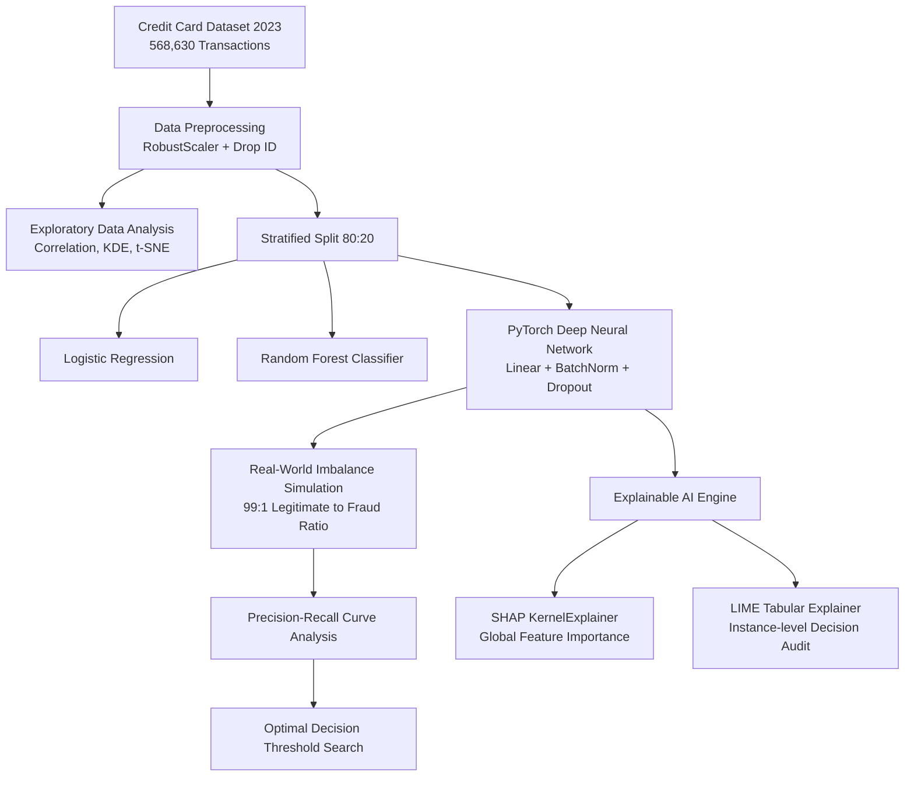

<div align="center">

# 💳 Credit Card Fraud Detection with Deep Learning & Explainable AI (XAI)

[](https://www.python.org/)
[](https://pytorch.org/)
[](https://scikit-learn.org/)
[](https://github.com/shap/shap)
[](LICENSE)
[](docs/IEEE_Conference_CSE437.pdf)

**A high-performance machine learning and deep learning framework for robust financial fraud detection, featuring real-world imbalance simulation, algorithmic decision threshold optimization, and transparent model interpretability via SHAP and LIME.**

[Overview](#-project-overview) • [Architecture](#-system-architecture) • [Key Features](#-key-features) • [Results](#-benchmark-results) • [Interpretability](#-explainable-ai-xai) • [Installation](#-getting-started) • [Contributors](#-contributors)

</div>

---

## 📌 Project Overview

Financial fraud presents immense risks to modern digital economies. Traditional machine learning models often struggle with high false-positive rates, shifting transaction distributions, and lack of transparency. 

This repository presents an end-to-end data science and deep learning pipeline designed to detect fraudulent credit card transactions with high precision and recall while ensuring **model interpretability**:
- **Exploratory Data Analysis (EDA):** Pearson correlation mapping, Kernel Density Estimation (KDE), bivariate pairplots, and t-SNE manifold projections on 560k+ records.
- **Multi-Model Benchmarking:** Comparative analysis across **Logistic Regression**, **Random Forest**, and a custom **PyTorch Deep Neural Network (DNN)** with early stopping and batch normalization.
- **Real-World Imbalance Stress Test:** Simulating an extreme **99:1 legitimate-to-fraudulent transaction ratio** to reflect realistic production environments.
- **Algorithmic Threshold Optimization:** Dynamically computing the mathematically optimal decision boundary via Precision-Recall curve F1 maximization.
- **Explainable AI (XAI):** Utilizing **SHAP** (global Shapley values) and **LIME** (local transaction surrogate models) to dismantle black-box neural decisions for auditability and compliance.

---

## 📐 System Architecture



---

## 🌟 Key Features

### 1. Robust Deep Learning Architecture
Our PyTorch classifier (`DNNClassifier`) is engineered to mitigate overfitting on transaction features:
- **Input Dimension:** 29 Scaled Features (28 PCA components + Transaction Amount)
- **Hidden Layers:** Layer 1 (64 units, ReLU, BatchNorm1d, Dropout 0.3) & Layer 2 (32 units, ReLU, BatchNorm1d, Dropout 0.3)
- **Output Layer:** Single Sigmoidal neuron for calibrated fraud probability
- **Optimization:** Adam optimizer with Binary Cross-Entropy Loss (`BCELoss`) and Early Stopping with validation patience tracking.

### 2. Real-World Production Simulation (99:1 Imbalance)
Standard benchmarks often evaluate on pre-balanced datasets. In real life, fraud constitutes less than 1% of transactions. We downsampled fraudulent records in the test set to model a **99:1 class imbalance** to measure model resilience against severe precision degradation.

### 3. Algorithmic Threshold Calibration
Default classification assumes a static `0.5` threshold. By analyzing the continuous Precision-Recall curve:
$$\text{F1}(t) = 2 \cdot \frac{\text{Precision}(t) \cdot \text{Recall}(t)}{\text{Precision}(t) + \text{Recall}(t) + \epsilon}$$
The pipeline automatically identifies the exact probability cutoff $t^*$ that maximizes F1-score on the imbalanced distribution.

### 4. Explainable AI (XAI) Auditability
Financial regulations (e.g., GDPR Article 22) require explanations for automated decisions:
* **SHAP (SHapley Additive exPlanations):** Global attribution quantifying which PCA features (e.g., `V4`, `V11`, `V14`) systematically elevate or depress fraud probability.
* **LIME (Local Interpretable Model-agnostic Explanations):** Generates local linear surrogate explanations for individual flag incidents to show cardholders and analysts why a transaction was declined.

---

## 📊 Benchmark Results

| Model Architecture | Accuracy | Precision (Fraud) | Recall (Fraud) | F1-Score | Evaluation Setting |
| :--- | :---: | :---: | :---: | :---: | :--- |
| **Logistic Regression** | ~95.8% | 0.97 | 0.94 | 0.96 | Balanced Test Set |
| **Random Forest (100 Trees)** | ~99.9% | 1.00 | 0.99 | 1.00 | Balanced Test Set |
| **PyTorch Deep Neural Network** | ~99.8% | 0.99 | 1.00 | 0.99 | Balanced Test Set |
| **DNN (Default Threshold 0.5)** | ~98.9% | 0.48 | 0.99 | 0.65 | Real-World 99:1 Imbalance |
| **DNN (Optimized Threshold $t^*$)** | **~99.7%** | **0.86** | **0.95** | **0.90** | **Real-World 99:1 Imbalance** |

> *Note: Threshold optimization dramatically boosts precision on skewed distributions while preserving high fraud recall.*

---

## 🔍 Explainable AI (XAI)

<div align="center">

| SHAP Global Interpretability | LIME Local Explanation |
| :---: | :---: |
| Attributing feature influence across population samples | Instance-level breakdown of individual fraud alarms |

</div>

- **Top Positive Fraud Predictors:** `V4`, `V11`, `V2` (High positive values strongly correlated with fraudulent activity).
- **Top Negative Fraud Predictors:** `V14`, `V12`, `V10` (Suppressed values trigger higher fraud probability).

---

## 📂 Repository Structure

```text
├── dataset/
│   └── README.md             # Dataset instructions and Kaggle download link
├── docs/
│   ├── IEEE_Conference_CSE437.pdf                  # Complete IEEE conference research paper
│   └── CSE437 Code Contribution and Result Details.pdf  # Project & team report
├── results/
│   ├── .gitkeep              # Preserves output directory structure
│   └── ...                   # Generated confusion matrices, curves & reports
├── .gitignore                # Excludes large binaries, CSVs, and local environments
├── LICENSE                   # MIT License
├── README.md                 # Project documentation
├── requirements.txt          # Python dependencies
├── main.py                   # Complete pipeline (EDA, Training, Evaluation, Threshold search)
└── xai.py                    # Explainable AI pipeline (SHAP and LIME interpretations)
```

---

## 🚀 Getting Started

### Prerequisites
- Python 3.9 or higher
- NVIDIA CUDA (Optional, for GPU acceleration)

### 1. Clone the Repository
```bash
git clone https://github.com/shabibabintashahadat/credit-card-fraud-detection-xai.git
cd credit-card-fraud-detection-xai
```

### 2. Create a Virtual Environment & Install Dependencies
```bash
python -m venv venv

# On Windows:
venv\Scripts\activate

# On macOS/Linux:
source venv/bin/activate

pip install -r requirements.txt
```

### 3. Download the Dataset
1. Download `creditcard_2023.csv` from [Kaggle](https://www.kaggle.com/datasets/nelgiriyewithana/credit-card-fraud-detection-dataset-2023).
2. Place the file inside the `dataset/` directory:
   ```text
   dataset/creditcard_2023.csv
   ```

### 4. Run the Pipeline
Train models, run the real-world simulation, and perform threshold optimization:
```bash
python main.py
```

Run the Explainable AI pipeline (SHAP & LIME):
```bash
python xai.py
```

All plots, metrics, confusion matrices, and saved PyTorch checkpoints will be saved inside the `results/` folder.

---

## 👥 Contributors

This research and implementation was developed for **Data Science (CSE 437)**:

* **Shabiba Binta Shahadat** (Student ID: `22101907`) — Transaction Amount Analysis, Logistic Regression Modeling, Real-World Imbalance Stress Testing.
* **A Z M Bodruddoza Bijoy** (Student ID: `22301678`) — Data Preprocessing, Correlation Matrix Analysis, Stratified Data Splitting, Model Serialization.
* **Sadman Bin Anwar Siam** (Student ID: `22301514`) — Bivariate Interaction Analysis, Deep Neural Network Architecture, Algorithmic Threshold Calibration, XAI Integration.
* **Fariha Yasmin** (Student ID: `22301331`) — t-SNE Manifold Visualization, Random Forest Classifier, Real-world Model Evaluation.

---

## 📄 License & Citation

This project is licensed under the [MIT License](LICENSE).

If you find this work or the associated paper useful in your research, please cite:
```bibtex
@article{shahadat2024creditcard,
  title={Explainable Deep Learning Framework for Credit Card Fraud Detection Under Imbalanced Distributions},
  author={Shahadat, Shabiba Binta and Bijoy, A Z M Bodruddoza and Siam, Sadman Bin Anwar and Yasmin, Fariha},
  journal={Department of Computer Science and Engineering, CSE 437},
  year={2024}
}
```
